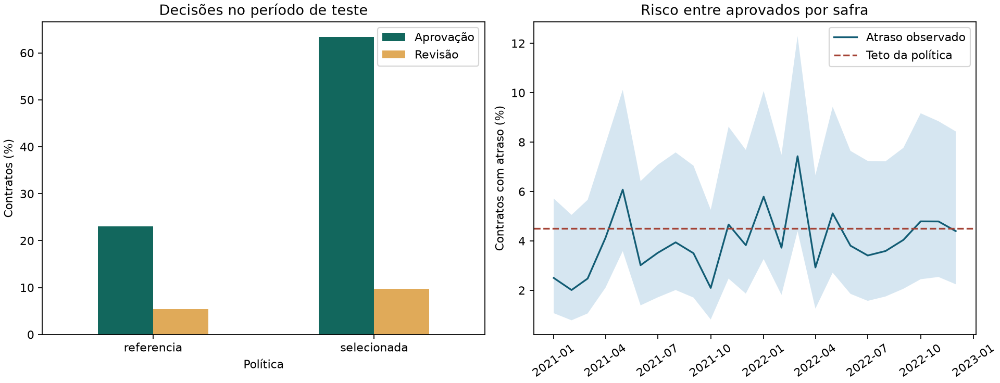

# Crédito sob restrições

**Qual política aprova mais contratos sem ultrapassar o risco aceito e a capacidade da equipe de revisão?** Este projeto reproduz a decisão de um comitê de crédito imobiliário em uma carteira sintética. A unidade de análise é o contrato. Uma *safra* reúne contratos iniciados no mesmo mês. Há três saídas possíveis para cada proposta: aprovar, revisar ou recusar.

**Decisão do estudo: manter a candidata em simulação.** Em 7.200 contratos futuros, a aprovação passou de 22,99% para 63,43%. Entre os 4.567 aprovados pela candidata, 181 atingiram atraso de 90 dias em até 12 meses. A taxa observada foi 3,96%, com intervalo de Wilson de 95% entre 3,43% e 4,57%. O comitê fictício exige que o limite superior fique em até 4,50%. O aumento de 40,44 pontos percentuais refere-se exclusivamente à carteira simulada.



## Executar no Windows com Visual Studio Code

Extraia o ZIP. Abra a pasta que contém este README em **File → Open Folder**. Abra **Terminal → New Terminal**. O ambiente usado para a entrega tinha Python 3.14.10. Estes comandos de PowerShell usam o executável do ambiente diretamente.

```powershell
py -3.14 -m venv .venv
.\.venv\Scripts\python.exe -m pip install -r requirements.txt
.\.venv\Scripts\python.exe -m unittest -v
.\.venv\Scripts\python.exe credito.py treinar --saida execucoes/minha-primeira
.\.venv\Scripts\python.exe relatorio.py execucoes/minha-primeira
.\.venv\Scripts\python.exe credito.py pontuar --modelo execucoes/minha-primeira/modelo.joblib --lote execucoes/minha-primeira/exemplo_lote.csv --saida execucoes/lote-pontuado.csv
.\.venv\Scripts\python.exe monitorar.py execucoes/minha-primeira execucoes/minha-primeira/exemplo_lote.csv execucoes/monitor-lote.csv
```

O treino imprime os indicadores e grava uma pasta nova. Para uma segunda execução, escolha outro nome. Abra `painel.png`, `resultado.json` e `politicas.csv` nessa pasta. Para ver a entrega imediatamente, os mesmos arquivos já estão em `resultados/`. Os arquivos joblib contêm objetos Python serializados. Carregue modelos que você gerou ou cuja origem verificou.

## As seis etapas do CRISP-DM

### 1. Entendimento do negócio

O responsável pela política escolhe o volume de aprovações diretas. A operação pode revisar até 10% das propostas. O orçamento de risco é 4,50% de contratos inadimplentes entre aprovados, verificado pelo limite superior do intervalo de 95%. Exigimos pelo menos 100 aprovações na validação. São premissas didáticas declaradas em `politica.py`. A aprovação após revisão, o lucro, a recuperação financeira e a experiência de clientes exigem dados adicionais.

A referência, definida antes da avaliação, aprova score a partir de 720, revisa de 710 até abaixo de 720 e recusa o restante. Ela representa uma regra simples de comparação. Maximizamos aprovações diretas entre os cortes candidatos que respeitam as duas restrições. A contagem de eventos evita que o percentual esconda o tamanho da amostra.

### 2. Entendimento dos dados

O gerador produz 300 contratos por mês, de janeiro de 2011 a janeiro de 2024, com semente 2026. A carteira contém 47.100 registros, dos quais 43.500 têm janela madura na data de corte. As quatro variáveis disponíveis na decisão são score de crédito, comprometimento da renda em %, relação entre financiamento e valor da garantia (LTV) em %, e valor financiado em unidades monetárias. Identificador e safra organizam registros. O mês do primeiro atraso serve exclusivamente para construir o desfecho.

O gerador introduz uma interação entre LTV e endividamento elevados, ausência parcial de comprometimento e aumento do risco a partir de 2022. Isso permite testar uma quebra de calibração conhecida. O comportamento simulado foi desenhado por nós. Consulte `perfil.csv` para distribuição, quartis e ausências e `safras.csv` para volume e frequência de atraso.

### 3. Preparação dos dados

Para um contrato de janeiro, observamos fevereiro até janeiro do ano seguinte, inclusive. Um primeiro atraso de 90 dias nessa janela gera alvo 1. Um contrato acompanhado durante a janela, sem evento, recebe 0. Removemos por inteiro as safras sem 12 meses completos na data de corte, inclusive eventos antecipados. A validação recusa IDs duplicados, linhas sem variáveis de risco e valores fora do domínio.

| Uso | Safras | Contratos |
|---|---|---:|
| Ajustar os modelos | 2011–2015 | 18.000 |
| Ajustar a calibração | 2017 | 3.600 |
| Selecionar modelo e cortes | 2019 | 3.600 |
| Avaliar a política congelada | 2021–2022 | 7.200 |

Os intervalos de 2016, 2018 e 2020 permitem que o último contrato de cada etapa complete 12 meses antes da próxima. Os demais registros maduros fora das janelas também ficam fora do ajuste. A data final de observação é janeiro de 2024. A regressão aprende mediana, indicador de ausência e escala exclusivamente no treino. As árvores tratam ausências nativamente.

### 4. Modelagem

Comparamos regressão logística e árvores de gradient boosting. Para cada alternativa testamos a probabilidade original e uma recalibração logística sobre as chances em escala logarítmica. Selecionamos a menor perda de Brier na validação, que penaliza a distância entre a probabilidade prevista e o evento observado. A logística calibrada venceu com 0,06818, contra 0,06831 da logística original. A diferença é pequena. O arquivo `modelos_validacao.csv` permite verificar as quatro configurações.

A política congelada aprova risco previsto até 7,977%, encaminha até 11,130% para revisão e recusa acima desse valor. O teto de 4,50% se aplica ao conjunto dos aprovados. A faixa de revisão usa a maior parcela permitida pela capacidade na grade de percentis. O estudo não atribui benefício financeiro fictício à revisão.

### 5. Avaliação

| Indicador no teste | Referência | Candidata |
|---|---:|---:|
| Aprovação direta | 22,99% | 63,43% |
| Revisão manual | 5,38% | 9,74% |
| Eventos entre aprovados | 26 / 1.655 | 181 / 4.567 |
| Risco observado | 1,57% | 3,96% |
| Limite superior de 95% | 2,29% | 4,57% |

No teste, a candidata alcançou ROC AUC de 0,803, precisão média (Average Precision) de 0,367 ante prevalência de 0,110, e Brier de 0,0831. Em 2021, a previsão média foi 8,57% e a frequência observada 8,67%. Em 2022, os valores foram 10,19% e 13,25%. O monitor registrou sete safras acima do teto observado de risco, oito acima da capacidade de revisão e nenhuma acima do limiar de mudança da distribuição dos scores. Monitorar a distribuição do score, isoladamente, deixaria passar essa deterioração.

O intervalo de Wilson descreve a incerteza binomial da proporção. Dependência entre safras ou choques comuns pode aumentar a incerteza. A busca entre cortes torna o intervalo da validação otimista como garantia de política. Por isso a decisão final usa o teste temporal congelado. Há um único período reservado. Antes de um piloto, repetir o desenho em novas safras e avaliar estabilidade, cobertura e disparidades entre segmentos pertinentes.

Para explorar o efeito de dois cortes já no teste:

```powershell
.\.venv\Scripts\python.exe credito.py simular --execucao resultados --corte-aprovar 0.05 --corte-revisar 0.08
```

Esse cenário reduz o risco observado para 2,87%, mas leva 16,03% à revisão. É análise de sensibilidade após abrir o teste. Uma nova política escolhida com esse conhecimento precisa de outra amostra futura para avaliação.

### 6. Implantação e monitoramento

A implantação do portfólio é um processo local de lote. O treino congela modelo, calibrador, limites, versão e identificação da origem. A pontuação entrega ID, safra, probabilidade em 12 meses, decisão e versão por linha. Cada execução nova preserva as anteriores. O identificador combina a versão declarada do código com um hash da carteira. Ao mudar a lógica, incremente a versão no código e registre o commit.

`monitorar.py` acompanha aprovação, revisão e deslocamento de distribuição (PSI) por safra contra a validação. O limiar didático de PSI é 0,20. Com CSV de acompanhamento e `--corte AAAA-MM-01`, calcula também risco realizado e intervalo apenas em safras maduras. Para monitorar contratos reais, a origem precisa garantir acompanhamento até a data declarada. Para investigar um alerta, confira volumes, ausências e calibração por safra; compare políticas em dados posteriores; preserve a execução anterior para reversão. A ação de negócio neste estudo é manter a regra de referência enquanto se testa uma nova candidata.

## Repetir com dados históricos

O treino aceita `--historico caminho.csv` junto de `--saida`. O contrato de entrada é `contrato,safra,score,comprometimento,ltv,valor,mes_evento`. Datas seguem AAAA-MM-DD. Evento vazio significa que houve acompanhamento suficiente para concluir ausência de atraso na janela, ou quitação documentada antes dele. Remova casos de acompanhamento desconhecido. O lote de pontuação dispensa `mes_evento`. Mantenha período, moeda, origem e definição de cada variável consistentes dentro de uma execução.

Incluímos um adaptador opcional para arquivos TXT originais da amostra Standard da Freddie Mac. Obtenha um par de originação e desempenho por ano nas condições do fornecedor e extraia os TXT delimitados por barra vertical. Para cada par:

```powershell
.\.venv\Scripts\python.exe importar_freddie.py origination.txt performance.txt safra_2017.csv
```

Concatene os CSVs anuais preservando apenas um cabeçalho e cobrindo todos os períodos de treino, calibração, validação e teste. A safra usada pelo adaptador é o mês anterior ao primeiro pagamento previsto, uma aproximação da originação. O evento é o primeiro mês com status numérico de atraso de pelo menos três parcelas no primeiro ano de pagamentos. A ausência de evento exige 12 competências válidas ou quitação voluntária com histórico completo. A contagem de excluídos deve acompanhar o relatório. O adaptador foi testado com arquivos de exemplo construídos para exercitar evento, quitação e censura. A entrega não inclui execução sobre a carteira Freddie Mac. [Dados e guia oficial](https://www.freddiemac.com/research/datasets/sf-loanlevel-dataset)

Uma base de empréstimos concedidos permite comparar filtros dentro da carteira histórica. O desempenho dos candidatos originalmente recusados continua desconhecido. A extensão para um banco brasileiro exigiria dados locais, comparabilidade do produto, análise dos grupos atendidos e validação independente.

## Mapa do repositório

| Arquivo | Onde entra |
|---|---|
| `dados.py` | Geração sintética, validação dos campos e construção temporal do alvo |
| `politica.py` | Critérios de risco e capacidade, intervalos, grade de cortes e métricas |
| `credito.py` | Treino, seleção, congelamento, teste, simulador e pontuação |
| `importar_freddie.py` | Conversão opcional de um par de arquivos históricos |
| `monitorar.py` | Acompanhamento de novos lotes com ou sem desfechos maduros |
| `relatorio.py` | Geração do painel com os dados de qualquer execução |
| `test_credito.py` | Oito testes de maturidade, dados, separação temporal, política, drift e importação |
| `requirements.txt`, `.vscode/`, `.gitignore` | Ambiente verificado, depuração no editor e exclusão de arquivos locais |
| `resultados/resultado.json`, `modelo.joblib` | Resumo, identificação da execução e modelo congelado |
| `resultados/perfil.csv`, `safras.csv` | Perfil das variáveis e distribuição do alvo por mês |
| `resultados/modelos_validacao.csv`, `fronteira_validacao.csv`, `politicas.csv` | Comparação de modelos, alternativas de decisão e referência |
| `resultados/teste_por_contrato.csv`, `calibracao_teste.csv` | Auditoria das decisões e calibração por faixa de risco |
| `resultados/referencia_pd.csv`, `monitoramento.csv`, `painel.png` | Distribuição de referência, indicadores mensais e visualização |
| `resultados/exemplo_lote.csv`, `pontuacao_exemplo.csv`, `monitor_exemplo.csv` | Entrada e saídas já executadas para a demonstração |

**Para apresentar o case em uma entrevista:** mostre a diferença entre o número de aprovações e o risco aceito, abra o gráfico por safra e explique por que a deterioração em 2022 motivou a decisão. A demonstração termina com a pontuação de um lote novo e com a recomendação que os resultados sustentam.
